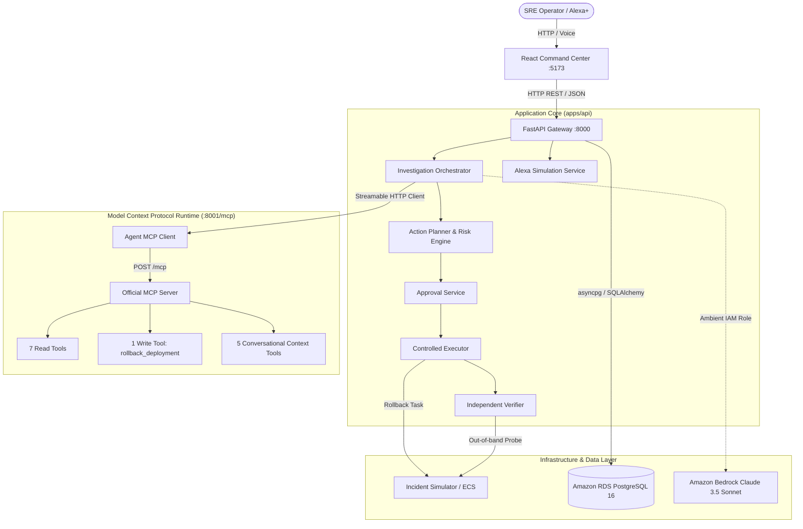
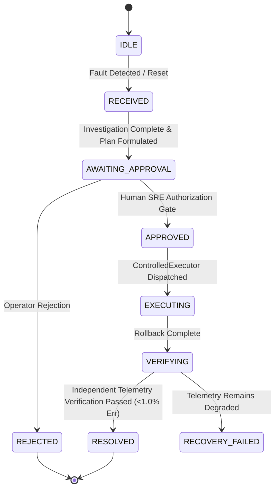

# RALLY — System Architecture & Implementation

> **Authoritative Technical Architecture Document**  
> **Platform:** RALLY — Agentic Reliability & Response Orchestration  
> **Stack:** FastAPI • Model Context Protocol (MCP) • React • TypeScript • Vite • PostgreSQL • AWS ECS Fargate • Amazon RDS • Amazon Bedrock  
> **Target Region:** `us-east-1`

---

## 1. System Overview

RALLY is an autonomous, human-governed site reliability engineering platform. Rather than acting as a passive alerting bot or conversational assistant, RALLY executes a closed-loop investigation and remediation workflow:

```text
               INCIDENT INGESTION (ALERTS / VOICE / CHAT)
                                  │
                                  ▼
                     AGENTIC ROOT-CAUSE REASONING
                                  │
                                  ▼
                   FORENSIC EVIDENCE ACCUMULATION
        [OBSERVED] ───────── [INFERRED] ───────── [PROPOSED]
                                  │
                                  ▼
                   DETERMINISTIC ACTION PLANNING
                        (Blast Radius & Risk)
                                  │
                                  ▼
                 ┌─────────────────────────────────┐
                 │  HUMAN GOVERNANCE APPROVAL GATE │
                 └─────────────────────────────────┘
                                  │
                                  ▼
                     CONTROLLED WRITE EXECUTION
                     (Targeted MCP Rollback)
                                  │
                                  ▼
                    INDEPENDENT VERIFICATION
                    (Out-of-band Telemetry)
                                  │
                                  ▼
                   RESOLVED & AUDITED INCIDENT STATE
```

---

## 2. Component Architecture



---

## 3. Production AWS Architecture

The production environment is deployed in AWS Region `us-east-1` using AWS CDK (`infra/`):

```mermaid
graph TD
    Internet((Internet Traffic)) -->|Port 80 HTTP| ALB[AWS Application Load Balancer<br>rally-public-alb]

    subgraph "VPC: 10.0.0.0/16 (NAT-less: 0 NAT Gateways)"
        subgraph "Public Subnets (us-east-1a, us-east-1b)"
            ALB
        end

        subgraph "Private Isolated Subnets (No Public IPs, assignPublicIp: false)"
            subgraph "ECS Fargate: RallyFargateService (Single Task)"
                direction TB
                FastAPIContainer["rally-api-container<br>FastAPI Gateway (:8000)"]
                MCPProcess["MCP Streamable HTTP Server<br>(127.0.0.1:8001/mcp)"]
                FastAPIContainer -->|Loopback :8001| MCPProcess
            end

            subgraph "Amazon RDS PostgreSQL 16.x"
                RDS[(RallyRdsInstance<br>db.t4g.micro<br>rds.force_ssl = 1<br>Port 5432)]
            end

            subgraph "AWS Private VPC Interface Endpoints"
                VPCE_Bedrock[Bedrock Runtime Endpoint :443]
                VPCE_Secrets[Secrets Manager Endpoint :443]
                VPCE_ECR[ECR API & Docker Endpoints :443]
                VPCE_Logs[CloudWatch Logs Endpoint :443]
            end

            FastAPIContainer -->|Port 5432 / SSL| RDS
            FastAPIContainer -->|Port 443 HTTPS| VPCE_Bedrock
            FastAPIContainer -->|Port 443 HTTPS| VPCE_Secrets
            FastAPIContainer -->|Port 443 HTTPS| VPCE_ECR
            FastAPIContainer -->|Port 443 HTTPS| VPCE_Logs
        end
    end

    ALB -->|Port 8000 (Target Group: tg-rally-api)| FastAPIContainer
```

### Key Security & Network Invariants:
1. **NAT-less VPC Architecture**: The compute task and database run in `PRIVATE_ISOLATED` subnets with zero NAT gateways, reducing idle AWS costs and preventing outbound internet egress.
2. **Loopback / Internal MCP Execution**: The MCP server runs within the same task boundary, binding to `127.0.0.1:8001`. The ALB target group forwards traffic solely to port 8000. Port 8001 is never exposed to the public internet or external VPC subnets.
3. **Database Isolation**: The RDS instance is strictly `publiclyAccessible: false`, enforced with SSL (`rds.force_ssl = 1`) and accessible only from the ECS security group on port 5432.
4. **Secrets Resolution**: Database credentials resolve at runtime from AWS Secrets Manager (`/rally/production/database`) via ambient IAM task execution credentials.

---

## 4. MCP Tool Layer (13 Tools)

RALLY implements the official Model Context Protocol (MCP) Python SDK over Streamable HTTP transport:

| Category | Tool Name | Mutating | Governance Required | Description |
| :--- | :--- | :--- | :--- | :--- |
| **READ** | `get_service_health` | No | No | Retrieves status, active deployment, and runtime flags. |
| **READ** | `get_error_rate` | No | No | Calculates 5xx error rate against certified health thresholds. |
| **READ** | `query_logs` | No | No | Filters operational log streams for stack traces and signatures. |
| **READ** | `get_recent_deployments`| No | No | Retrieves release history, git commit references, and timestamps. |
| **READ** | `get_deployment_diff` | No | No | Inspects syntactic code and configuration diffs between tags. |
| **READ** | `get_dependency_health`| No | No | Probes upstream/downstream services and circuit breakers. |
| **READ** | `get_runbook` | No | No | Fetches certified SRE standard operating procedures. |
| **WRITE** | `rollback_deployment` | **Yes** | **MANDATORY** | Reverts active deployment to predecessor stable release. |
| **CONTEXT** | `get_incident_context` | No | No | Returns authoritative multi-turn incident state and metadata. |
| **CONTEXT** | `get_investigation_summary`| No | No | Generates structured natural language narrative of findings. |
| **CONTEXT** | `get_action_plan` | No | No | Returns proposed remediation plan, blast radius, and risk level. |
| **CONTEXT** | `get_execution_status` | No | No | Tracks execution progress (enforces `NOT_EXECUTED` pre-approval).|
| **CONTEXT** | `get_verification_status`| No | No | Returns post-remediation independent verification metrics. |

---

## 5. Epistemic Evidence Ledger & Reasoning

To prevent hallucinated remediation, RALLY classifies every evidentiary artifact with an **epistemic provenance label**:

```text
[OBSERVED]   Hard factual data returned directly by an MCP read tool.
    │        (e.g., "HTTP 5xx error rate is 18.4% (> 1.0% threshold)")
    ▼
[INFERRED]   Root-cause hypothesis derived by agent reasoning.
    │        (e.g., "Deployment checkout-v42 is primary root cause, 95% confidence")
    ▼
[PROPOSED]   Remediation action formulated by deterministic planner.
    │        (e.g., "Rollback checkout-v42 to checkout-v41; blast radius: HIGH")
    ▼
[APPROVED]   Human SRE operator governance decision.
    │        (e.g., "Authorized by sre-lead@rally.internal")
    ▼
[EXECUTED]   Controlled execution record dispatched by ControlledExecutor.
    │        (e.g., "Dispatched rollback_deployment via MCP")
    ▼
[VERIFIED]   Out-of-band recovery confirmation from IndependentVerifier.
             (e.g., "Error rate restored to 0.70%, checkout-v41 active")
```

---

## 6. Safety & Governance State Machine

State transitions are strictly one-way and validated by backend business logic:



### Invariants:
- Unapproved actions remain **`NOT_EXECUTED`**.
- An agent or automated system entity cannot approve its own action plan.
- Replaying an approval request returns the existing authoritative state without re-executing mutations.
