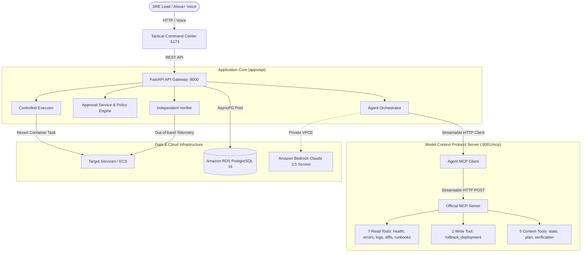

# RALLY

<div align="center">

**Agentic Reliability & Response Orchestration**

[](file:///Users/sandygen/Ankit%20Parida/Amazon_AI_Hackathon/RALLY/tests)
[](file:///Users/sandygen/Ankit%20Parida/Amazon_AI_Hackathon/RALLY/apps/api)
[](file:///Users/sandygen/Ankit%20Parida/Amazon_AI_Hackathon/RALLY/apps/web)
[](https://modelcontextprotocol.io)
[](file:///Users/sandygen/Ankit%20Parida/Amazon_AI_Hackathon/RALLY/infra)
[](file:///Users/sandygen/Ankit%20Parida/Amazon_AI_Hackathon/RALLY/LICENSE)

*An autonomous, human-governed site reliability engineering platform that investigates production incidents, correlates epistemic evidence, formulates risk-evaluated action plans, enforces human authorization, executes remediation through official Model Context Protocol (MCP) tools, and independently verifies system recovery.*

</div>

---

## The Problem

Production site reliability incidents are high-stress and error-prone. Modern cloud architectures generate immense volumes of telemetry across logs, metrics, deployments, and dependency traces. When a critical service regresses, engineering teams face significant friction:
1. **Telemetry Overload**: Engineers spend 80% of incident time querying disconnected observability tools.
2. **Hallucination & AI Risk**: Generic conversational LLMs lack operational guardrails, proposing speculative fixes or attempting unverified mutations.
3. **The Autonomy Paradox**: Fully autonomous agents cannot be safely trusted with production write permissions, while purely passive chatbots fail to relieve on-call cognitive load.

---

## The Solution: RALLY

RALLY solves this through an **Agentic Investigation & Zero-Bypass Governance Architecture**:
- **Autonomous Investigation**: RALLY connects to operational services via the **Model Context Protocol (MCP)**, querying health, error rates, structured logs, deployment diffs, and runbooks over Streamable HTTP.
- **Epistemic Evidence Ledger**: Every evidentiary artifact is labeled with strict epistemic provenance (`OBSERVED`, `INFERRED`, `PROPOSED`, `APPROVED`, `EXECUTED`, `VERIFIED`), distinguishing hard telemetry from deductive inferences.
- **Zero-Bypass Human Governance Gate**: Destructive actions (e.g. rolling back deployments) **cannot self-execute**. RALLY calculates blast radius, evaluates risk, formulates a reversibility plan, and halts for explicit human SRE authorization.
- **Controlled Execution & Independent Verification**: Once authorized, a controlled executor dispatches the remediation tool, followed immediately by an out-of-band telemetry verification sweep to assert true restoration before closing the incident.

---

## Core Workflow

```text
                  INCIDENT INGESTION (ALERTS / VOICE / CHAT)
                                     │
                                     ▼
                    AGENTIC ROOT-CAUSE REASONING
                    (Amazon Bedrock Claude 3.5 Sonnet)
                                     │
                                     ▼
                   FORENSIC EVIDENCE ACCUMULATION
           [OBSERVED] ───────── [INFERRED] ───────── [PROPOSED]
                                     │
                                     ▼
                   DETERMINISTIC ACTION PLANNING
                        (Blast Radius & Risk)
                                     │
                                     ▼
                    ┌─────────────────────────────────┐
                    │  HUMAN GOVERNANCE APPROVAL GATE │
                    │ (Zero-Bypass SRE Authorization) │
                    └─────────────────────────────────┘
                                     │
                                     ▼
                        CONTROLLED WRITE EXECUTION
                     (Targeted MCP rollback_deployment)
                                     │
                                     ▼
                       INDEPENDENT VERIFICATION
                      (Out-of-band Telemetry Probe)
                                     │
                                     ▼
                      RESOLVED & AUDITED INCIDENT
```

---

## Why RALLY is Different

| Capability | Generic DevOps Chatbots | Raw Autonomous Agents | RALLY Platform |
| :--- | :--- | :--- | :--- |
| **Tool Interface** | Proprietary API wrappers | Arbitrary shell / bash execution | **Official MCP Python SDK (Streamable HTTP)** |
| **Safety Boundary** | Suggestion text only | Dangerous unconstrained writes | **Deterministic Policy & Human Approval Gate** |
| **Evidence Truth** | Hallucinated context | Unverified assumptions | **Strict Epistemic Classification (`OBSERVED` vs `INFERRED`)** |
| **Verification** | Assumes action worked | Relies on LLM self-evaluation | **Independent Out-of-Band Telemetry Probing** |
| **Auditability** | Ephemeral chat transcript | Inconsistent execution logs | **Structured Mutation Audit Trail** |

---

## Architecture

RALLY operates across three tiers:
1. **Command Center UI (`apps/web`)**: A high-density tactical interface built with React, TypeScript, Vite, and Tailwind CSS.
2. **FastAPI Gateway (`apps/api`)**: High-performance asynchronous API coordinating the agent orchestrator, governance planner, and execution engine.
3. **MCP Runtime (`rally_mcp`)**: Streamable HTTP MCP server exposing 13 operational tools bound to domain infrastructure.



---

## MCP Tool Layer (13 Tools)

RALLY implements the official Model Context Protocol (MCP) Python SDK over Streamable HTTP transport:

### 1. READ Tools (Observability & Telemetry)
- `get_service_health`: Returns service operational status and active deployment identifier.
- `get_error_rate`: Calculates 5xx error rate percentages against certified health thresholds.
- `query_logs`: Queries structured application log streams for stack traces and signatures.
- `get_recent_deployments`: Returns release history in reverse-chronological order.
- `get_deployment_diff`: Syntactic code and configuration diff inspector between tags.
- `get_dependency_health`: Evaluates downstream service dependencies and circuit breakers.
- `get_runbook`: Fetches certified SRE standard operating procedures and recovery instructions.

### 2. WRITE Tools (Governed Remediation)
- `rollback_deployment`: Controlled deployment rollback. **MANDATORY HUMAN SRE GOVERNANCE REQUIRED**.

### 3. CONTEXT Tools (Conversational & Voice State)
- `get_incident_context`: Authoritative multi-turn incident context and identifiers.
- `get_investigation_summary`: Structured natural language summary of findings and evidence.
- `get_action_plan`: Remediation action plan, blast radius risk score, and policy requirements.
- `get_execution_status`: Tracks execution status (enforcing `NOT_EXECUTED` prior to approval).
- `get_verification_status`: Post-remediation independent verification metrics and recovery decision.

*For full schemas and parameter contracts, see [docs/MCP.md](docs/MCP.md).*

---

## AWS Production Architecture

RALLY is provisioned in AWS Region **`us-east-1`** using AWS CDK:

```text
THE INTERNET
     │
     ▼ (Port 80 HTTP)
[Public Application Load Balancer: rally-public-alb]
     │
     ▼ (Port 8000 only)
[Private Isolated Subnet: No Public IPs]
     ├── ECS Fargate Single-Task Service: rally-api (:8000)
     │       └── Internal Loopback: MCP Streamable HTTP (:8001/mcp)
     ├── Amazon RDS PostgreSQL 16.x (Single-AZ, db.t4g.micro, Force SSL)
     └── AWS Private Interface VPC Endpoints (:443 HTTPS)
             ├── Bedrock Runtime
             ├── Secrets Manager (/rally/production/database)
             ├── ECR Container Registry
             └── CloudWatch Logs
```

- **NAT-less VPC Architecture**: Zero NAT gateways, saving unnecessary AWS charges while strictly preventing unauthorized internet egress.
- **Loopback MCP Isolation**: MCP port `8001` runs within the container execution boundary and is **never exposed** to the public ALB or internet ingress.
- **Database Security**: Enforced SSL (`rds.force_ssl = 1`) with credentials sourced dynamically from AWS Secrets Manager.

---

## The Verified Golden Demo Scenario

RALLY contains a deterministic verification workflow simulating a critical Tier-1 checkout regression:

```text
1. RESET FAULT
   Fault injected: CHECKOUT_REGRESSION in checkout-v42.
   Telemetry: HTTP 5xx error rate spikes to 18.4% (Threshold: <1.0%).

2. AUTONOMOUS INVESTIGATION
   User asks: "Investigate the checkout incident."
   Agent dispatches MCP read tools across health, telemetry, logs, diffs, and dependencies.
   Evidence compiled: Unhandled SchemaValidationError in order_validator.py.
   Root cause deduced: CHECKOUT_VALIDATION_REGRESSION (Agent confidence: 95%).

3. REMEDIATION ACTION PLAN
   Action proposed: rollback_deployment (checkout-v42 -> checkout-v41).
   Risk Engine assessment: HIGH risk (Score: 65).
   SAFETY INVARIANT: Execution status remains strictly NOT_EXECUTED.

4. HUMAN GOVERNANCE GATE
   Lead SRE operator reviews diff and blast radius in the Command Center.
   Operator submits explicit authorization decision.

5. CONTROLLED EXECUTION & INDEPENDENT VERIFICATION
   ControlledExecutor dispatches rollback_deployment.
   IndependentVerifier probes telemetry directly out-of-band.
   Telemetry confirmed restored to 0.70% error rate (<1.0%).
   Active deployment reinstated: checkout-v41.
   Incident state transitions to RESOLVED with immutable audit trail.
```

*For complete step-by-step commands, see [DEMO.md](DEMO.md).*

---

## Getting Started

### Prerequisites
- Python 3.12+
- Node.js 20+ & npm 9+
- Docker & Docker Compose v2

### One-Command Startup
To launch the complete local stack (FastAPI on `:8000`, MCP on `:8001`, and React on `:5173`):
```bash
git clone https://github.com/ProxyJazzz/RALLY.git
cd RALLY
./start.sh
```

### Manual Service Boot

#### 1. Setup Backend
```bash
cd apps/api
python3 -m venv .venv
source .venv/bin/activate
pip install -e ".[dev]"
cp ../../.env.example .env
alembic upgrade head
uvicorn app.main:app --host 0.0.0.0 --port 8000 --reload
```

#### 2. Start MCP Server
```bash
# In a separate terminal with .venv active:
python -m rally_mcp.server
# Runs on http://127.0.0.1:8001/mcp
```

#### 3. Setup Frontend
```bash
cd apps/web
npm install
npm run dev
# Command Center runs at http://localhost:5173
```

---

## Running Tests & Verification

### Automated Test Suite
```bash
./apps/api/.venv/bin/pytest -q
# Result: 152 passed, 1 skipped (optional AWS live credentials test)
```

### Production Frontend Build
```bash
npm run build --prefix apps/web
# Result: tsc -b && vite build (Clean 0 errors, 339 kB bundle)
```

### Code Style & Formatting
```bash
git diff --check
# Result: 0 whitespace or formatting errors
```

---

## Project Structure

```text
RALLY/
├── apps/
│   ├── api/                   # FastAPI backend application
│   │   ├── app/               # Routes, core config, database models, schemas
│   │   ├── Dockerfile.prod    # Hardened multi-stage unprivileged production image
│   │   └── pyproject.toml     # Python dependencies & metadata
│   └── web/                   # React command center application
│       ├── src/               # Tactical Noir UI components & views
│       └── package.json       # Frontend dependencies & build scripts
├── agent/                     # Autonomous agent orchestrator & epistemic evidence
├── alexa/                     # Alexa+ multi-turn context adapters & conversational tools
├── aws/                       # AWS provider integration (Bedrock Converse API)
├── docs/                      # Authoritative specifications (API, MCP, ARCHITECTURE)
├── execution/                 # Controlled executor & independent verifier
├── governance/                # Action planner, risk matrix & approval gate
├── infra/                     # AWS CDK infrastructure definitions (ECS, RDS, VPC)
├── rally_mcp/                 # Official MCP Streamable HTTP server & tools
├── simulator/                 # Deterministic incident simulation engine
├── tests/                     # 153 automated integration & unit tests
├── .env.example               # Safe environment configuration template
├── start.sh                   # One-command local startup script
└── README.md                  # This file
```

---

## Known Limitations

- **Multi-Task Idempotency**: In-memory approval idempotency tracking is safe for single-task ECS (`desiredCount = 1`). Multi-task horizontal scaling requires persisting idempotency keys into the PostgreSQL database.
- **ALB HTTPS Listener**: The current Application Load Balancer operates over HTTP Port 80 for hackathon evaluation. Enterprise production deployment requires attaching an AWS ACM certificate and Route 53 domain on Port 443.

---

## Documentation Index

- [ARCHITECTURE.md](ARCHITECTURE.md) — Comprehensive technical architecture & AWS topology.
- [SECURITY.md](SECURITY.md) — Security model, authorization gates, and threat mitigation.
- [DEPLOYMENT.md](DEPLOYMENT.md) — Step-by-step local and AWS CDK deployment guide.
- [DEMO.md](DEMO.md) — 3-minute judge walkthrough script.
- [docs/API.md](docs/API.md) — REST API endpoint reference.
- [docs/MCP.md](docs/MCP.md) — Model Context Protocol tool contracts.

---

## License

This project is licensed under the terms of the [MIT License](LICENSE).
Copyright (c) 2026 Ankit Parida.
